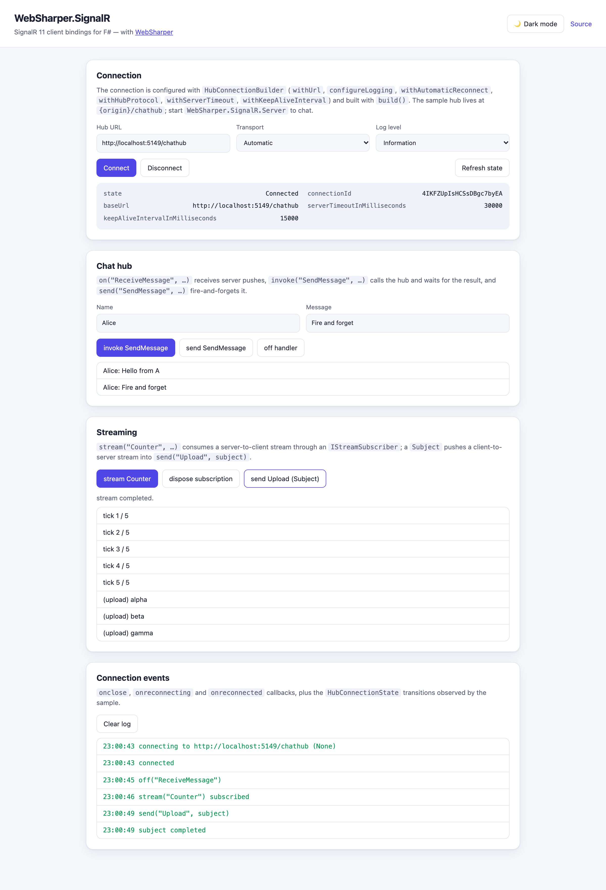

# WebSharper.SignalR

[](https://www.nuget.org/packages/WebSharper.SignalR)

WebSharper bindings for the [ASP.NET Core SignalR JavaScript client](https://learn.microsoft.com/aspnet/core/signalr/javascript-client)
([`@microsoft/signalr`](https://www.npmjs.com/package/@microsoft/signalr) 11.x) — real-time
hubs and streaming for F# and C# web apps.

The binding consumes the npm package `@microsoft/signalr` as an ES module
(`import { HubConnectionBuilder } from "@microsoft/signalr"`) and is bundled by your
toolchain (esbuild in the sample); there is no CDN `<script>` tag.

This repository contains:

| Project | Purpose |
| --- | --- |
| `WebSharper.SignalR` | The binding: WIG definitions for `HubConnectionBuilder`, `HubConnection`, `JsonHubProtocol`, `Subject`, the `HttpClient` family, the error types, the hub-message interfaces and the `LogLevel` / `HttpTransportType` / `MessageType` / `TransferFormat` / `HubConnectionState` enumerations. |
| `WebSharper.SignalR.Sample` | A WebSharper SPA (esbuild → `dist/`) that drives the whole client surface: building and starting a connection, chat through `invoke` / `send` / `on` / `off`, a server-to-client `stream` and a client-to-server `Subject`, plus the connection-state events. |
| `WebSharper.SignalR.Server` | A small ASP.NET Core host exposing the `ChatHub` the sample connects to. It is not part of the NuGet package; it exists so the sample has a real hub to talk to. |

## Live demos

**Try it live:** [Open the sample in your browser](https://dotnet-websharper.github.io/signalr/)



The sample doubles as the binding's [test case](#running-the-test-case): it
configures a `HubConnection` with `HubConnectionBuilder`, connects, exchanges
messages with `on` / `invoke` / `send` / `off`, consumes a server-to-client
`stream` through an `IStreamSubscriber`, pushes a client-to-server stream with a
`Subject`, and logs the `onclose` / `onreconnecting` / `onreconnected` callbacks.
It is light-themed by default and has a light/dark theme switcher (persisted in
`localStorage`).

> A SignalR client needs a hub. The published page renders the whole client UI
> and degrades gracefully when no hub is reachable, but the chat only works when
> a server is running — use the bundled `WebSharper.SignalR.Server` locally for
> the complete flow (see [Running the test case](#running-the-test-case)).

- **Sample (this repository):** <https://dotnet-websharper.github.io/signalr/>
- **Source repository:** <https://github.com/dotnet-websharper/signalr>
- **WebSharper bindings:** <https://websharper.com/bindings>

## Install

```bash
dotnet add package WebSharper.SignalR
```

Or with Paket:

```fsharp
nuget WebSharper.SignalR
```

The package targets `netstandard2.0` and works with any WebSharper 10 or 11
project. It supports `@microsoft/signalr >= 11.0.0 < 12.0.0`; the JS package is
pulled from npm, so the bundle step must be able to resolve it (WebSharper's
SPA/esbuild build does this automatically).

## Usage

All types live in the `WebSharper.SignalR` namespace, under the `SignalR`
container (`SignalR.HubConnectionBuilder`, `SignalR.HubConnection<_>`, …), so

```fsharp
open WebSharper
open WebSharper.JavaScript
open WebSharper.SignalR
```

### Connect and call the hub

```fsharp
[<JavaScript>]
module Chat =

    let connection : SignalR.HubConnection<string> =
        SignalR.HubConnectionBuilder()
            .WithUrl("https://example.com/chathub")
            .ConfigureLogging(SignalR.LogLevel.Information)
            .WithHubProtocol(SignalR.JsonHubProtocol())
            .WithAutomaticReconnect()
            .Build()

    let start () =
        // SignalR delivers hub-method arguments one by one; `on` hands them to
        // the handler as a single array.
        connection.On("ReceiveMessage", fun args ->
            Console.Log(sprintf "%s: %s" (args.[0] :?> string) (args.[1] :?> string)))

        connection.Onclose(fun (error: Error) -> Console.Log "closed")
        connection.Onreconnecting(fun (error: Error) -> Console.Log "reconnecting")
        connection.Onreconnected(fun (id: string) -> Console.Log "reconnected")

        connection.Start() |> ignore

    let send (message: string) =
        // `invoke` / `send` / `stream` spread the argument array into the
        // hub method's parameters, exactly like the JS client.
        connection.Invoke("SendMessage", [| "me" :> obj; message :> obj |]) |> ignore
```

### Streaming

```fsharp
// Server to client: subscribe with an IStreamSubscriber.
let subscription =
    connection.Stream("Counter", [| 5 :> obj |])
        .Subscribe(
            { new SignalR.IStreamSubscriber<string> with
                member _.Closed = Optional.Undefined
                member _.Next(item) = Console.Log item
                member _.Error(err) = Console.Log "stream error"
                member _.Complete() = Console.Log "done" })

// ... and dispose it to stop the stream.
subscription.Dispose()

// Client to server: push items through a Subject.
let subject = SignalR.Subject<string>()
connection.Send("Upload", [| subject :> obj |]) |> ignore
subject.Next("alpha")
subject.Complete()
```

`IHttpConnectionOptions` carries the request-level settings of `withUrl`
(`httpClient`, `headers`, `logger`, `logMessageContent`, `skipNegotiation`,
`transport`, `WebSocket`, `EventSource`, `accessTokenFactory`,
`withCredentials`, `timeout`), and the remaining configuration goes through the
dedicated builder methods (`configureLogging`, `withHubProtocol`,
`withAutomaticReconnect`, `withServerTimeout`, `withKeepAliveInterval`,
`withStatefulReconnect`).

## Running the test case

The sample is a client SPA; the `WebSharper.SignalR.Server` project hosts the
`ChatHub` and serves the built SPA from the same origin.

```bash
# Build the SPA (esbuild bundles @microsoft/signalr) and start the hub host.
dotnet build WebSharper.SignalR.Sample/WebSharper.SignalR.Sample.fsproj -c Release
dotnet run --project WebSharper.SignalR.Server -c Release
```

Then open <http://localhost:5149/>. Open it in a second tab or browser to see
messages fan out between clients, press **stream Counter** for the
server-to-client stream and **send Upload (Subject)** for the client-to-server
one.

To serve only the static output:

```bash
dotnet build WebSharper.SignalR.Sample/WebSharper.SignalR.Sample.fsproj -c Release
dotnet serve -d dist -p 8080          # dotnet tool install -g dotnet-serve
```

The page will load and show that no hub is reachable at `/chathub`.

## Building from source

```bash
dotnet tool restore
dotnet paket restore
dotnet build WebSharper.SignalR.sln -c Release
```

The binding targets `netstandard2.0`; the sample and the hub host target
`net10.0`. This branch pins the WebSharper 10 line (`nuget WebSharper ~> 10.0`,
currently 10.1.10.687) and builds with the .NET 10 SDK.

## Deployment

Pushing to `main` triggers `.github/workflows/ghpages.yml`, which builds the
sample in Release (Paket restore, esbuild bundle) and publishes `dist/` to the
`gh-pages` branch. The hub host is not deployed.

## Repository layout

```
WebSharper.SignalR/            # binding (WIG definitions, npm-based)
  Main.fs
WebSharper.SignalR.Sample/     # SPA sample / test case
  Client.fs
  index.html
  site.css
  esbuild.config.mjs
WebSharper.SignalR.Server/     # ASP.NET Core host with the ChatHub
  Program.fs
docs/sample.png
.github/workflows/ghpages.yml  # build + deploy the sample to GitHub Pages
```

## Notes on the API

- **`invoke` / `send` / `stream` take an argument array** (`obj[]`), matching the
  F# side, and the binding spreads it into the JS client's variadic call.
- **`on` handlers receive the arguments as a single `obj[]`.** SignalR calls
  client methods with the arguments spread out; the binding registers a small
  adapter so the handler sees the array. The adapter is cached on the handler
  function, so `off (methodName, handler)` removes exactly what `on` registered.
- **`HubConnectionState` is a string enum** (`Connected`, `Connecting`,
  `Disconnected`, `Disconnecting`, `Reconnecting`) and is read as a string.
- **`logMessageContent`** should stay `false` in production — message content can
  contain sensitive user data.
- **The `Server` project is a test fixture**, not something to ship; any ASP.NET
  Core SignalR hub works with the binding.

## License

Apache 2.0 — see [LICENSE.md](LICENSE.md).
